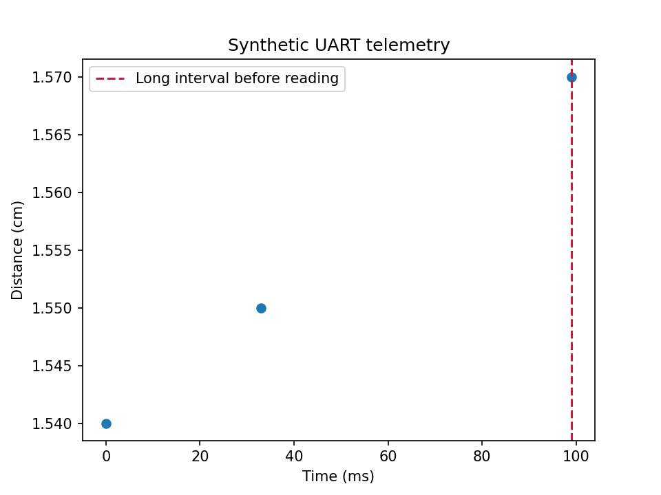

# UART Telemetry Validator

A Python tool for decoding four-byte UART distance readings and checking the timing of synthetic telemetry. It uses the message format from my MSPM0 infrared telemetry project. The examples run without hardware and do not use live UART captures.

## How it works

Each message starts with `<` followed by three ASCII digits. For example, `<154` represents 1.54 cm.

The streaming decoder keeps incomplete messages between reads. If a candidate is malformed, the decoder advances one byte and tries again so it can find the next valid message.

```python
from telemetry.stream import FrameDecoder

decoder = FrameDecoder()
print(decoder.feed(b"<1"))          # []
print(decoder.feed(b"54<000"))      # [1.54, 0.0]
print(decoder.feed(b"x<2A0<235"))   # [2.35]
```

## Run the tests

From the repository root:

```bash
python3 -m unittest discover -s tests -v
```

The 10 unit tests cover frame parsing, recovery after malformed input, messages split across reads, and timing-gap detection.

## Replay synthetic readings

```bash
python3 -m pip install -r requirements.txt
python3 -m telemetry.replay
```

The example replays readings at 0, 33, and 99 ms. The 66 ms interval before the final reading exceeds the 50 ms threshold, so the tool flags a possible missed sample. Because the protocol has no sequence counter, timing alone cannot confirm that a sample was lost.


